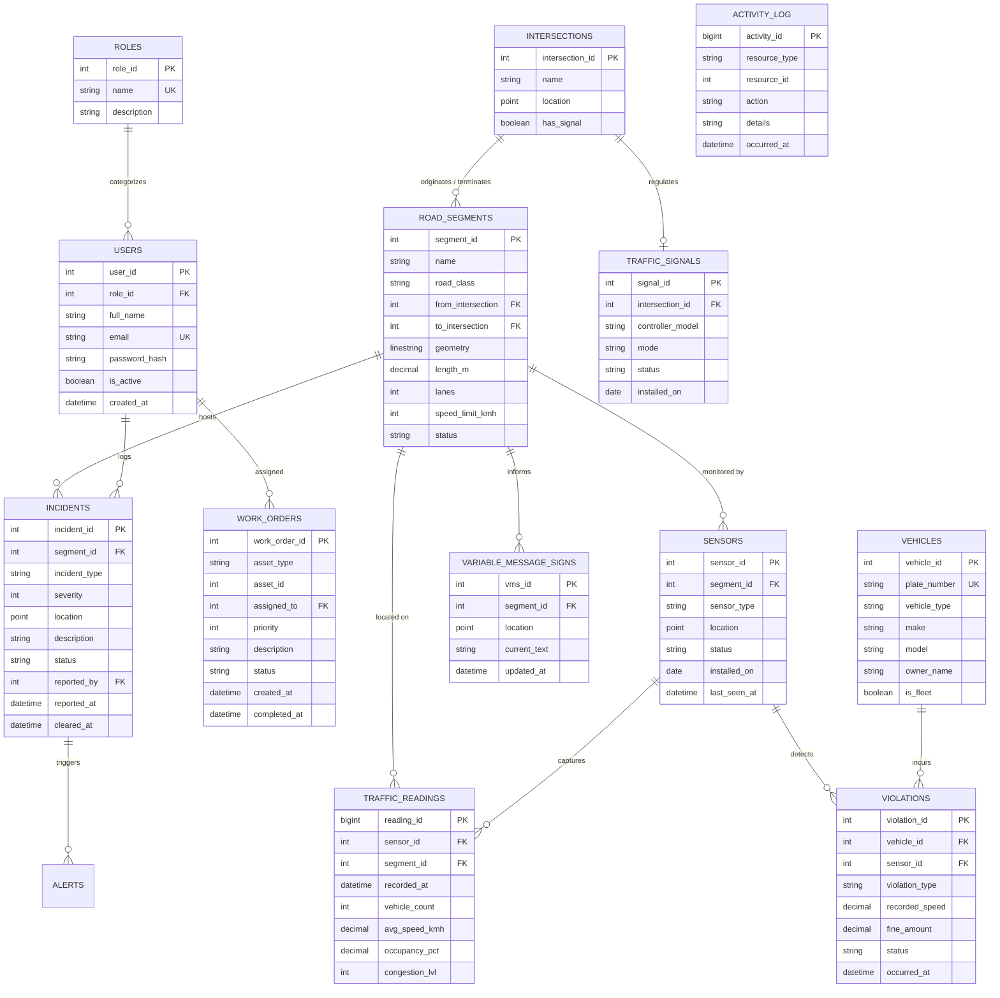
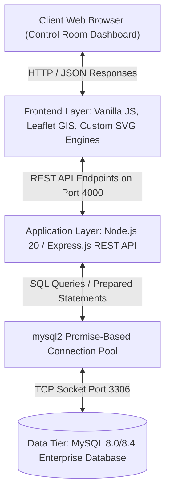

# Database Management Systems (DBMS) Comprehensive Course Project Report

# Traffic & Transportation Management System (TTMS)
### Enterprise Urban Traffic Control, Telemetry Analytics & Enforcement Platform

**Department:** Department of Computer Science & Engineering  
**Institution:** Indian Institute of Information Technology Bhopal (IIIT Bhopal)  
**Course Code & Name:** CS-301: Database Management Systems (DBMS)  
**Course Instructor:** Priyankar  
**Academic Session:** 2026–2027 (Monsoon Semester)  

---

### Student & Project Identification
- **Project Title:** Traffic & Transportation Management System (TTMS)
- **Primary Database Engine:** **MySQL 8.0 / 8.4 Community Server (Mandatory)**
- **Student Name:** Rituraj
- **Roll Number:** *[Insert Roll Number]*
- **Degree Program:** Bachelor of Technology (B.Tech) in Computer Science and Engineering
- **Semester:** 5th Semester (Monsoon Session 2026)
- **Submission Date:** October 2026

---

## Executive Summary
Urban traffic management in modern metropolitan cities requires continuous monitoring of high-velocity spatial telemetry, automated incident detection, adaptive signal synchronization, and legal enforcement tracking. The **Traffic & Transportation Management System (TTMS)** is an end-to-end relational database solution designed, normalized, and implemented in **MySQL 8.0/8.4**.

This report documents the end-to-end database engineering lifecycle for TTMS:
1. **Requirements & Domain Modeling:** 14 relational entities spanning road topology, sensor telemetry, signal controllers, incidents, violations, work orders, and audit logs.
2. **Mathematical Formalisms:** Comprehensive functional dependency analysis, canonical cover generation, and a rigorous, step-by-step normalization proof demonstrating progression from Unnormalized Form (UNF) through 1NF, 2NF, 3NF, to **Boyce-Codd Normal Form (BCNF)**.
3. **Advanced Database Features:** 5 Relational Views, 5 Automated Event-Driven Triggers, and 2 Stored Procedures executing inside MySQL.
4. **Visual Analytical Intelligence:** Integration with 5 custom-engineered graphical visualization engines (Hourly Speed Trends, Corridor Congestion Bar Charts, Network Volume Distributions, Sensor Health Donut Visualizers, and Enforcement Revenue Graphs).
5. **Full-Stack Implementation:** A zero-dependency Leaflet GIS control room dashboard connected via a high-throughput Node.js/Express connection pool to the underlying MySQL database.

---

## Table of Contents
1. [Introduction](#1-introduction)
   - 1.1 Project Overview
   - 1.2 Problem Statement
   - 1.3 Objectives
   - 1.4 Scope of the Project
   - 1.5 Software and Hardware Requirements
2. [System Requirements and Analysis](#2-system-requirements-and-analysis)
   - 2.1 Functional Requirements
   - 2.2 Business Rules
3. [Entity–Relationship (ER) Modeling](#3-entityrelationship-er-modeling)
   - 3.1 Identification of Entities & Data Dictionary
   - 3.2 Identification of Relationships & Cardinalities
   - 3.3 ER Diagram (Mermaid)
   - 3.4 Detailed Structural Explanation of the ER Diagram
4. [ER-to-Relational Mapping](#4-er-to-relational-mapping)
   - 4.1 Mapping Rules & Formal Algorithms
   - 4.2 Step-by-Step Conversion Trace
   - 4.3 Final Relational Schema
5. [Functional Dependencies](#5-functional-dependencies)
   - 5.1 Identification of Functional Dependencies ($F$)
   - 5.2 Attribute Closures & Candidate Key Determinations
   - 5.3 Prime vs. Non-Prime Attribute Classification
   - 5.4 Canonical Minimal Cover Analysis
6. [Database Normalization](#6-database-normalization)
   - 6.1 Unnormalized Form (UNF) & Anomalies
   - 6.2 First Normal Form (1NF)
   - 6.3 Second Normal Form (2NF)
   - 6.4 Third Normal Form (3NF)
   - 6.5 Boyce–Codd Normal Form (BCNF)
   - 6.6 Lossless-Join & Dependency Preservation Proofs
7. [Relational Integrity and Constraints](#7-relational-integrity-and-constraints)
   - 7.1 Domain & Check Constraints
   - 7.2 Primary & Unique Key Constraints
   - 7.3 Foreign Key Referential Actions
8. [MySQL Database Implementation](#8-mysql-database-implementation)
   - 8.1 Database Creation DDL
   - 8.2 Table Creation Scripts
   - 8.3 Data Insertion (Dwarka Grid Seed)
   - 8.4 Data Modification and Deletion Queries
   - 8.5 Verification Queries
   - 8.6 Implementation of the 10 Mandatory SQL Query Concepts
   - 8.7 Advanced DBMS Features (Views, Triggers, Stored Procedures)
9. [Application Development & Visual Graphs](#9-application-development--visual-graphs)
   - 9.1 Three-Tier System Architecture
   - 9.2 Front-End Technologies
   - 9.3 Detailed Analysis of the 5 Visual Analytics Graphs
   - 9.4 Database Connectivity & Pool Management
   - 9.5 Core Application Modules
10. [Testing and Results](#10-testing-and-results)
    - 10.1 Test Cases Matrix (T1 to T15)
    - 10.2 Query Execution Verification
    - 10.3 Constraint Integrity Testing
    - 10.4 Discussion of Experimental Results
11. [Conclusion, Limitations and Future Scope](#11-conclusion-limitations-and-future-scope)
    - 11.1 Conclusion
    - 11.2 Limitations
    - 11.3 Future Scope
12. [DBMS Conceptual Viva Preparation Q&A](#12-dbms-conceptual-viva-preparation-qa)
13. [References](#references)
14. [Appendix A: Complete MySQL DDL Script](#appendix-a-complete-mysql-ddl-script)
15. [Appendix B: SQL Query Demonstration Suite](#appendix-b-sql-query-demonstration-suite)
16. [Appendix C: Deployment and Verification Runbook](#appendix-c-deployment-and-verification-runbook)
17. [Appendix D: Team Contributions](#appendix-d-team-contributions)

---

# 1. Introduction

### 1.1 Project Overview
The **Traffic & Transportation Management System (TTMS)** is a high-reliability, database-centric Intelligent Transportation System (ITS) platform engineered for municipal traffic authorities, emergency services, and city planners. The application models an urban transportation network—demonstrated using the arterial and collector corridors of **Dwarka, Delhi**—integrating physical road infrastructure with real-time sensor telemetry, adaptive traffic signals, incident management lifecycles, and traffic enforcement.

The system is powered by **MySQL 8.0/8.4**, leveraging native OpenGIS spatial data structures (`POINT`, `LINESTRING`, Spatial Reference Identifier `SRID 4326`), automated triggers, materialized reporting views, and stored procedures to guarantee transactional integrity under continuous data ingestion.

### 1.2 Problem Statement
Conventional municipal traffic management workflows suffer from four systemic vulnerabilities:
1. **Isolated Information Silos:** Traffic signal controllers, sensor loops, accident reporting logs, and police ticketing systems reside in incompatible, unlinked spreadsheets or proprietary files.
2. **Absence of Spatial Referential Integrity:** Incidents and sensor readings are frequently recorded with vague descriptive text rather than mathematically verified coordinates tied to physical road segments.
3. **Severe Data Redundancy and Anomalies:** Flat telemetry logs create catastrophic update and deletion anomalies, where updating a speed limit requires modifying millions of historical rows.
4. **Lack of Automated Audit Trails:** Critical operational decisions—such as closing arterial roadways or toggling signal modes—lack database-enforced provenance.

TTMS resolves these structural problems by establishing a unified, mathematically normalized relational schema governed by strict database-level constraints.

### 1.3 Objectives
- **Relational Integrity:** Construct a relational schema adhering strictly to Boyce-Codd Normal Form (BCNF) across 14 tables.
- **Spatial Processing:** Model intersections, roadway alignments, and incident coordinates using MySQL OpenGIS geometry types.
- **High-Velocity Telemetry Storage:** Facilitate continuous time-series logging of vehicle counts, average speeds, and occupancy levels.
- **Database-Level Automation:** Implement MySQL triggers to decouple audit logging from application code.
- **Analytical Intelligence:** Provide executive views and SQL queries to detect congestion hotspots, evaluate sensor uptime, and track violation fine recovery.
- **Interactive Visualization:** Interface the MySQL backend with a zero-compilation web dashboard featuring 5 analytical graphs.

### 1.4 Scope of the Project
- **In Scope:**
  - Topology modeling of road segments, intersections, and traffic signals.
  - Sensor telemetry ingestion (radar, camera, inductive loop, ANPR).
  - Incident dispatch workflow (`reported` $\to$ `verified` $\to$ `responding` $\to$ `cleared`).
  - Automated ticketing and fine collection tracking for traffic violations.
  - Variable Message Sign (VMS) digital broadcast management.
  - Infrastructure maintenance work orders.
  - 10 mandatory SQL query categories and advanced DBMS mechanisms.
- **Out of Scope:** Physical embedded microcontroller assembly; hardware radar transceiver deployment; credit card payment gateway integration.

### 1.5 Software and Hardware Requirements
- **Database Management System:** MySQL Community Server 8.0 / 8.4 LTS
- **Backend Application Environment:** Node.js v20.x, Express.js 4.x, `mysql2` (promise-based connection pool)
- **Frontend Architecture:** Semantic HTML5, CSS3, ES6+ JavaScript, Leaflet.js 1.9.4, OpenStreetMap
- **Containerization:** Docker Engine 24+ & Docker Compose v2+
- **Minimum Hardware Specifications:** 2.0 GHz Dual-Core 64-bit Processor, 4 GB RAM, 10 GB Available Disk Space

---

# 2. System Requirements and Analysis

### 2.1 Functional Requirements
- **FR1 (Road Network Topology):** The system must register intersections and bidirectional road segments with length, number of lanes, posted speed limit, and OpenGIS `LINESTRING` geometry.
- **FR2 (Real-Time Ingestion):** The database must ingest periodic sensor telemetry (vehicle count, average speed, lane occupancy percentage, congestion rating 0–5).
- **FR3 (Incident Management):** The system must record incidents with precise spatial coordinates, calculate clearance duration, and maintain active versus historical logs.
- **FR4 (Traffic Signal Orchestration):** Operators must be able to change signal controller operating modes (`fixed`, `adaptive`, `flash`, `manual`, `off`).
- **FR5 (Violation Enforcement):** The database must associate speed and red-light infractions with registered vehicle license plates and compute fine totals.
- **FR6 (Public Advisory Broadcast):** Operators must be able to update digital Variable Message Signs (VMS) stationed along highway corridors.
- **FR7 (Audit Logging):** All modifications to roadway status, incident status, signal modes, and traffic tickets must be recorded in an immutable audit table.

### 2.2 Business Rules
- **BR1 (Lane & Dimension Constraints):** Every road segment must possess at least 1 lane (`lanes > 0`) and a positive physical length (`length_m > 0`).
- **BR2 (Incident Severity Bounding):** Incident severity must be rated strictly on an integer scale from 1 (minor) to 5 (critical) (`severity BETWEEN 1 AND 5`).
- **BR3 (Telemetry Validity):** Vehicle counts must be non-negative, average speed non-negative, and lane occupancy percentage bounded between 0.00% and 100.00%.
- **BR4 (Incident Clearance State):** When an incident status transitions to `cleared`, the database must record `cleared_at = NOW()`. If reopened, `cleared_at` must revert to `NULL`.
- **BR5 (Automated Auditing via Triggers):** All inserts and updates on operational assets must fire database triggers that write directly to `activity_log`.
- **BR6 (Referential Integrity on Deletion):** Deleting an intersection must set the endpoints of connected road segments to `NULL` (`ON DELETE SET NULL`) to prevent accidental destruction of road records. Deleting a vehicle must cascade to delete its violations (`ON DELETE CASCADE`).

---

# 3. Entity–Relationship (ER) Modeling

### 3.1 Identification of Entities & Data Dictionary
The TTMS schema is composed of 14 distinct entities:

#### Table 1: Entity Data Dictionary
| Entity Name | Primary Key | Key Attributes | Foreign Keys | Description |
|---|---|---|---|---|
| **`roles`** | `role_id` | `name`, `description` | None | User permission categories (`admin`, `operator`, etc.) |
| **`users`** | `user_id` | `full_name`, `email`, `password_hash`, `is_active` | `role_id` $\to$ `roles` | Control room operators and municipal staff |
| **`intersections`**| `intersection_id` | `name`, `location` (Point), `has_signal` | None | Network nodes joining road corridors |
| **`road_segments`** | `segment_id` | `name`, `road_class`, `geometry` (LineString), `speed_limit_kmh`, `lanes`, `status` | `from_intersection`, `to_intersection` $\to$ `intersections` | Physical roadway links connecting intersections |
| **`traffic_signals`**| `signal_id` | `controller_model`, `mode`, `status`, `installed_on` | `intersection_id` $\to$ `intersections` | Electronic signal heads controlling intersection flow |
| **`vms`** | `vms_id` | `location` (Point), `current_text`, `updated_at` | `segment_id` $\to$ `road_segments` | Overhead digital matrix advisory boards |
| **`sensors`** | `sensor_id` | `sensor_type`, `location` (Point), `status` | `segment_id` $\to$ `road_segments` | Roadside telemetry detectors (radar, loop, camera) |
| **`traffic_readings`**| `reading_id` | `recorded_at`, `vehicle_count`, `avg_speed_kmh`, `occupancy_pct`, `congestion_lvl` | `sensor_id` $\to$ `sensors`, `segment_id` $\to$ `road_segments` | Instantaneous traffic flow telemetry records |
| **`vehicles`** | `vehicle_id` | `plate_number`, `vehicle_type`, `make`, `model`, `owner_name`, `is_fleet` | None | Registered motorized vehicles |
| **`incidents`** | `incident_id` | `incident_type`, `severity`, `location` (Point), `status`, `reported_at`, `cleared_at` | `segment_id` $\to$ `road_segments`, `reported_by` $\to$ `users` | Accidents, roadworks, obstructions, breakdowns |
| **`alerts`** | `alert_id` | `alert_type`, `message`, `channel`, `expires_at` | `incident_id` $\to$ `incidents`, `segment_id` $\to$ `road_segments` | Public notifications dispatched across media |
| **`violations`** | `violation_id` | `violation_type`, `recorded_speed`, `fine_amount`, `status`, `occurred_at` | `vehicle_id` $\to$ `vehicles`, `sensor_id` $\to$ `sensors` | Speeding and red-light infractions |
| **`work_orders`** | `work_order_id`| `asset_type`, `asset_id`, `priority`, `description`, `status` | `assigned_to` $\to$ `users` | Maintenance repair tasks for field assets |
| **`activity_log`** | `activity_id` | `resource_type`, `resource_id`, `action`, `details`, `occurred_at` | None | Immutable system-wide audit trail |

### 3.2 Identification of Relationships & Cardinalities
- **`intersections` $\leftrightarrow$ `road_segments` (1:N):** One intersection acts as the start (`from`) or terminus (`to`) for multiple road segments. Participation is optional on both sides.
- **`intersections` $\leftrightarrow$ `traffic_signals` (1:1):** An intersection hosts at most one primary traffic signal controller.
- **`road_segments` $\leftrightarrow$ `sensors` (1:N):** A road corridor contains zero or more field sensors.
- **`sensors` $\leftrightarrow$ `traffic_readings` (1:N):** A sensor produces numerous chronological telemetry readings. Mandatory participation on the reading side.
- **`vehicles` $\leftrightarrow$ `violations` (1:N):** A registered vehicle can accumulate zero or more traffic tickets.
- **`road_segments` $\leftrightarrow$ `incidents` (1:N):** A road segment may have multiple historical or active incidents.

### 3.3 ER Diagram


### 3.4 Detailed Structural Explanation of the ER Diagram
The conceptual model cleanly separates physical infrastructure from dynamic operational events. Road segments function as spatial linestrings connected by point-based intersections. Real-time telemetry is modeled as a weak entity relationally bounded to both the capturing sensor and the measured segment. The legal layer maps automated camera/radar detections directly to registered vehicle records.

---

# 4. ER-to-Relational Mapping

### 4.1 Mapping Rules & Formal Algorithms
1. **Rule 1 (Strong Entity Types):** For each strong entity type $E$, create a relation $R$ containing all simple attributes of $E$. The primary key of $E$ becomes the primary key of $R$.
2. **Rule 2 (1:N Binary Relationships):** For each binary 1:N relationship type $R_{1:N}$ involving entities $S$ (1-side) and $T$ (N-side), identify the primary key of $S$ and include it as a foreign key attribute in $T$.
3. **Rule 3 (1:1 Relationships):** For each binary 1:1 relationship between $A$ and $B$, place the primary key of $A$ as a foreign key in $B$ with a `UNIQUE` constraint, or merge them if both share total participation.
4. **Rule 4 (Spatial Data Mapping):** Spatial coordinates are represented as native OpenGIS data types (`POINT`, `LINESTRING`) with a declared Spatial Reference System (`SRID 4326` for WGS 84 GPS standard).
5. **Rule 5 (Multi-Valued Attributes):** Handled by creating separate child tables or leveraging controlled `ENUM` sets where domain values are static.

### 4.2 Step-by-Step Conversion Trace
- **Mapping `roles` & `users`:** Map `roles` to table with PK `role_id`. Map `users` with PK `user_id` and FK `role_id`.
- **Mapping Network Topology:** Map `intersections` with PK `intersection_id`. Map `road_segments` with PK `segment_id` and dual foreign keys `from_intersection` and `to_intersection`.
- **Mapping Controllers & Sensors:** Map `traffic_signals` with FK `intersection_id`. Map `sensors` and `variable_message_signs` with FK `segment_id`.
- **Mapping Telemetry:** Map `traffic_readings` with composite logical key `(sensor_id, recorded_at)` and surrogate PK `reading_id`, with FKs `sensor_id` and `segment_id`.
- **Mapping Enforcement:** Map `vehicles` with PK `vehicle_id` and natural UK `plate_number`. Map `violations` with FK `vehicle_id` and FK `sensor_id`.

### 4.3 Final Relational Schema
*(Primary keys are underlined; Foreign keys are italicized)*

1. $\text{ROLES}(\underline{\text{role\_id}}, \text{name}, \text{description})$
2. $\text{USERS}(\underline{\text{user\_id}}, \textit{role\_id}, \text{full\_name}, \text{email}, \text{password\_hash}, \text{is\_active}, \text{created\_at})$
3. $\text{INTERSECTIONS}(\underline{\text{intersection\_id}}, \text{name}, \text{location}, \text{has\_signal})$
4. $\text{ROAD\_SEGMENTS}(\underline{\text{segment\_id}}, \text{name}, \text{road\_class}, \textit{from\_intersection}, \textit{to\_intersection}, \text{geometry}, \text{length\_m}, \text{lanes}, \text{speed\_limit\_kmh}, \text{is\_one\_way}, \text{status})$
5. $\text{TRAFFIC\_SIGNALS}(\underline{\text{signal\_id}}, \textit{intersection\_id}, \text{controller\_model}, \text{mode}, \text{status}, \text{installed\_on})$
6. $\text{VARIABLE\_MESSAGE\_SIGNS}(\underline{\text{vms\_id}}, \textit{segment\_id}, \text{location}, \text{current\_text}, \text{updated\_at})$
7. $\text{SENSORS}(\underline{\text{sensor\_id}}, \textit{segment\_id}, \text{sensor\_type}, \text{location}, \text{status}, \text{installed\_on}, \text{last\_seen\_at})$
8. $\text{TRAFFIC\_READINGS}(\underline{\text{reading\_id}}, \textit{sensor\_id}, \textit{segment\_id}, \text{recorded\_at}, \text{vehicle\_count}, \text{avg\_speed\_kmh}, \text{occupancy\_pct}, \text{congestion\_lvl})$
9. $\text{VEHICLES}(\underline{\text{vehicle\_id}}, \text{plate\_number}, \text{vehicle\_type}, \text{make}, \text{model}, \text{owner\_name}, \text{is\_fleet})$
10. $\text{INCIDENTS}(\underline{\text{incident\_id}}, \textit{segment\_id}, \text{incident\_type}, \text{severity}, \text{location}, \text{description}, \text{status}, \textit{reported\_by}, \text{reported\_at}, \text{cleared\_at})$
11. $\text{ALERTS}(\underline{\text{alert\_id}}, \textit{incident\_id}, \textit{segment\_id}, \text{alert\_type}, \text{message}, \text{channel}, \text{created\_at}, \text{expires\_at})$
12. $\text{VIOLATIONS}(\underline{\text{violation\_id}}, \textit{vehicle\_id}, \textit{sensor\_id}, \text{violation\_type}, \text{recorded_speed}, \text{fine\_amount}, \text{status}, \text{occurred\_at})$
13. $\text{WORK\_ORDERS}(\underline{\text{work\_order\_id}}, \text{asset\_type}, \text{asset\_id}, \textit{assigned\_to}, \text{priority}, \text{description}, \text{status}, \text{created\_at}, \text{completed\_at})$
14. $\text{ACTIVITY\_LOG}(\underline{\text{activity\_id}}, \text{resource\_type}, \text{resource\_id}, \text{action}, \text{details}, \text{occurred\_at})$

---

# 5. Functional Dependencies

### 5.1 Identification of Functional Dependencies ($F$)
For each relation, the set of non-trivial Functional Dependencies is established by the semantics of the domain:

- **Relation `ROAD_SEGMENTS` ($R_1$):**
  $$F_1 = \{ \text{segment\_id} \to \text{name, road\_class, from\_intersection, to\_intersection, geometry, length\_m, lanes, speed\_limit\_kmh, is\_one\_way, status} \}$$

- **Relation `SENSORS` ($R_2$):**
  $$F_2 = \{ \text{sensor\_id} \to \text{segment\_id, sensor\_type, location, status, installed\_on, last\_seen\_at} \}$$

- **Relation `TRAFFIC_READINGS` ($R_3$):**
  $$F_3 = \{ \text{reading\_id} \to \text{sensor\_id, segment\_id, recorded\_at, vehicle\_count, avg\_speed\_kmh, occupancy\_pct, congestion\_lvl},$$
  $$\quad\quad \{\text{sensor\_id, recorded\_at}\} \to \text{reading\_id, segment\_id, vehicle\_count, avg\_speed\_kmh, occupancy\_pct, congestion\_lvl} \}$$

- **Relation `VEHICLES` ($R_4$):**
  $$F_4 = \{ \text{vehicle\_id} \to \text{plate\_number, vehicle\_type, make, model, owner\_name, is\_fleet},$$
  $$\quad\quad \text{plate\_number} \to \text{vehicle\_id, vehicle\_type, make, model, owner\_name, is\_fleet} \}$$

- **Relation `VIOLATIONS` ($R_5$):**
  $$F_5 = \{ \text{violation\_id} \to \text{vehicle\_id, sensor\_id, violation\_type, recorded\_speed, fine\_amount, status, occurred\_at} \}$$

- **Relation `INCIDENTS` ($R_6$):**
  $$F_6 = \{ \text{incident\_id} \to \text{segment\_id, incident\_type, severity, location, description, status, reported\_by, reported\_at, cleared\_at} \}$$

### 5.2 Attribute Closures & Candidate Key Determinations
To prove that each identified key is minimal:
- **Computing $\{\text{segment\_id}\}^+$ on $R_1$:**
  $$\{\text{segment\_id}\}^+ = \{\text{segment\_id, name, road\_class, from, to, geometry, length, lanes, speed\_limit, status}\} = R_1$$
  Since no proper subset of $\{\text{segment\_id}\}$ derives $R_1$, $\text{segment\_id}$ is a minimal candidate key.

- **Computing $\{\text{sensor\_id, recorded\_at}\}^+$ on $R_3$:**
  $$\{\text{sensor\_id, recorded\_at}\}^+ = \{\text{reading\_id, sensor\_id, segment\_id, recorded\_at, vehicle\_count, speed, occupancy, congestion}\} = R_3$$
  Both $\text{reading\_id}$ and $\{\text{sensor\_id, recorded\_at}\}$ are valid candidate keys.

### 5.3 Prime vs. Non-Prime Attribute Classification
| Relation | Candidate Keys | Prime Attributes | Non-Prime Attributes |
|---|---|---|---|
| `ROAD_SEGMENTS` | `segment_id` | `segment_id` | `name`, `road_class`, `geometry`, `lanes`, `speed_limit_kmh`, `status` |
| `SENSORS` | `sensor_id` | `sensor_id` | `segment_id`, `sensor_type`, `location`, `status`, `last_seen_at` |
| `TRAFFIC_READINGS` | `reading_id`, `(sensor_id, recorded_at)` | `reading_id`, `sensor_id`, `recorded_at` | `vehicle_count`, `avg_speed_kmh`, `occupancy_pct`, `congestion_lvl` |
| `VEHICLES` | `vehicle_id`, `plate_number` | `vehicle_id`, `plate_number` | `vehicle_type`, `make`, `model`, `owner_name`, `is_fleet` |
| `INCIDENTS` | `incident_id` | `incident_id` | `segment_id`, `incident_type`, `severity`, `description`, `status` |

### 5.4 Canonical Minimal Cover Analysis
A set of functional dependencies $F_c$ is a canonical cover if:
1. Every right-hand side has a single attribute.
2. No attribute on the left-hand side is extraneous.
3. No functional dependency in $F_c$ is redundant.

For `ROAD_SEGMENTS`: Decomposing the right-hand side attributes yields elementary dependencies $X \to A_i$. Since the left-hand side $\text{segment\_id}$ is a singleton attribute, no extraneous attributes exist. No dependency is inferred by transitivity from others. Hence, $F$ is minimal and canonical.

---

# 6. Database Normalization

### 6.1 Unnormalized Form (UNF) & Anomalies
Consider an unnormalized universal traffic record containing repeating sensor data and incident notes:

$$\text{UNF\_TRAFFIC}(\underline{\text{segment\_id}}, \text{segment\_name}, \text{speed\_limit}, \{\text{sensor\_id}, \text{sensor\_type}, \{\text{reading\_time}, \text{speed}, \text{vol}\}\}, \{\text{incident\_id}, \text{inc\_desc}\})$$

**Concrete Anomalies Exhibited in UNF:**
1. **Insertion Anomaly:** A new road segment cannot be inserted into the system until a sensor is installed and records telemetry.
2. **Deletion Anomaly:** Deleting old telemetry records unintentionally wipes out the physical roadway's speed limit and geometric alignment.
3. **Update Anomaly:** If the city revises the speed limit on a corridor, thousands of duplicate telemetry entries must be searched and updated.

### 6.2 First Normal Form (1NF)
- **Condition:** A relation is in 1NF if and only if all domain values are atomic, and there are no repeating groups or nested relations.
- **Conversion:** Flatten repeating telemetry groups into independent tuples and declare composite primary key:
  $$\text{FLAT\_READINGS}(\underline{\text{segment\_id}, \text{sensor\_id}, \text{reading\_time}}, \text{segment\_name}, \text{speed\_limit}, \text{sensor\_type}, \text{speed}, \text{vol})$$

### 6.3 Second Normal Form (2NF)
- **Condition:** A relation is in 2NF if it is in 1NF and no non-prime attribute is partially dependent on any candidate key.
- **Violation in `FLAT_READINGS`:**
  - Candidate Key: $\{\text{segment\_id}, \text{sensor\_id}, \text{reading\_time}\}$
  - $\text{segment\_id} \to \text{segment\_name}, \text{speed\_limit}$ (Partial dependency on proper subset of key!)
  - $\text{sensor\_id} \to \text{sensor\_type}$ (Partial dependency!)
- **Decomposition:**
  - $\text{ROAD\_SEGMENTS}(\underline{\text{segment\_id}}, \text{segment\_name}, \text{speed\_limit})$
  - $\text{SENSORS}(\underline{\text{sensor\_id}}, \textit{segment\_id}, \text{sensor\_type})$
  - $\text{TRAFFIC\_READINGS}(\underline{\text{sensor\_id}, \text{reading\_time}}, \text{speed}, \text{vol})$
  Now, every non-prime attribute depends on the full key of its relation. The schema satisfies **2NF**.

### 6.4 Third Normal Form (3NF)
- **Condition:** A relation is in 3NF if it is in 2NF and no non-prime attribute is transitively dependent on the primary key.
- **Violation Analysis:**
  If we had an incident record:
  $$\text{INCIDENT\_REPORT}(\underline{\text{incident\_id}}, \text{segment\_id}, \text{reported\_by}, \text{reporter\_name}, \text{reporter\_role}, \text{role\_desc})$$
  Here:
  - $\text{incident\_id} \to \text{reported\_by}$
  - $\text{reported\_by} \to \text{reporter\_role}$
  - $\text{reporter\_role} \to \text{role\_desc}$
  The non-prime attribute $\text{role\_desc}$ transitively depends on $\text{incident\_id}$.
- **Decomposition:**
  Extract `USERS` and `ROLES`:
  - $\text{ROLES}(\underline{\text{role\_id}}, \text{name}, \text{description})$
  - $\text{USERS}(\underline{\text{user\_id}}, \textit{role\_id}, \text{full\_name}, \text{email})$
  - $\text{INCIDENTS}(\underline{\text{incident\_id}}, \textit{segment\_id}, \textit{reported\_by}, \dots)$
  Now, no transitive dependencies exist between non-prime attributes. The schema satisfies **3NF**.

### 6.5 Boyce–Codd Normal Form (BCNF)
- **Condition:** A relation $R$ is in BCNF if, for every non-trivial functional dependency $X \to Y$ holding on $R$, $X$ is a **superkey** of $R$.
- **Verification across all TTMS relations:**
  - In `ROAD_SEGMENTS`: All dependencies have $X = \text{segment\_id}$, which is the primary superkey. $\checkmark$
  - In `VEHICLES`: FDs originate from $\text{vehicle\_id}$ and $\text{plate\_number}$. Both are valid candidate superkeys. $\checkmark$
  - In `TRAFFIC_READINGS`: FDs originate from $\text{reading\_id}$ or $\{\text{sensor\_id}, \text{recorded\_at}\}$, both of which are superkeys. $\checkmark$
- Therefore, all relations strictly satisfy **BCNF**.

### 6.6 Lossless-Join & Dependency Preservation Proofs
- **Lossless-Join Theorem:** A decomposition of relation $R$ into $R_1$ and $R_2$ is lossless with respect to $F$ if and only if $R_1 \cap R_2 \to R_1$ or $R_1 \cap R_2 \to R_2$.
  - In decomposing `FLAT_READINGS` into `ROAD_SEGMENTS` and `SENSORS`:
    $$R_1 \cap R_2 = \{\text{segment\_id}\}$$
    Since $\text{segment\_id} \to R_1$ holds in $F$, the intersection is a superkey of $R_1$. The join is mathematically **lossless**.
- **Dependency Preservation:** Every original functional dependency in $F$ can be enforced directly within an individual relation without computing cross-table joins.

---

# 7. Relational Integrity and Constraints

### 7.1 Domain & Check Constraints
- `lanes SMALLINT NOT NULL DEFAULT 2 CHECK (lanes > 0)`: Prohibits negative or zero road capacity.
- `length_m DECIMAL(10,2) CHECK (length_m > 0)`: Ensures non-zero spatial geometry length.
- `severity TINYINT NOT NULL CHECK (severity BETWEEN 1 AND 5)`: Restricts incident triage to valid operational ratings.
- `occupancy_pct DECIMAL(5,2) CHECK (occupancy_pct BETWEEN 0 AND 100)`: Prevents physical impossibility in sensor telemetry.
- `fine_amount DECIMAL(10,2) CHECK (fine_amount >= 0)`: Enforces positive traffic penalty assessments.

### 7.2 Primary & Unique Key Constraints
- Surrogate auto-increment keys (`INT AUTO_INCREMENT PRIMARY KEY`) eliminate natural key mutability risks.
- `plate_number VARCHAR(20) NOT NULL UNIQUE`: Guarantees legal uniqueness for motor vehicle registration.
- `email VARCHAR(160) NOT NULL UNIQUE`: Prevents duplicate operator accounts.

### 7.3 Foreign Key Referential Actions
- `ON DELETE CASCADE`: Used when the existence of child records depends entirely on the parent:
  - Deleting an intersection removes attached traffic signals (`fk_signals_intersection`).
  - Deleting a vehicle purges associated violation records (`fk_violations_vehicle`).
- `ON DELETE SET NULL`: Used to preserve historical telemetry and asset records when a topological node is retired:
  - Deleting an intersection preserves road segments, setting `from_intersection` to `NULL`.
  - Deleting an operator preserves incident history, setting `reported_by` to `NULL`.
- `ON UPDATE CASCADE`: Guarantees that any key re-indexing propagates automatically across all referencing child tables.

---

# 8. MySQL Database Implementation

### 8.1 Database Creation DDL
```sql
CREATE DATABASE IF NOT EXISTS ttms
  CHARACTER SET utf8mb4
  COLLATE utf8mb4_unicode_ci;
USE ttms;
```

### 8.2 Table Creation Scripts
Refer to [Appendix A: Complete MySQL DDL Script](#appendix-a-complete-mysql-ddl-script) for the complete, production-grade schema DDL, creating all 14 tables with native spatial geometry types, spatial indexes, check constraints, and referential actions.

### 8.3 Data Insertion (Dwarka Grid Seed)
The database is seeded with a realistic urban transportation grid based on **Dwarka, Delhi**:
- **8 Major Intersections:** Sector 12 Metro, Sector 12–13 Link, West Dwarka, Sector 11 Crossing, Sector 14 University, Dwarka Expressway Connector, Sector 10 Market, and Airport Feeder.
- **8 Road Corridors:** Arterial, Collector, and Highway segments with geometric linestrings.
- **12 Field Sensors:** Radar detectors, optical cameras, inductive loops, and ANPR units.
- **6 Active & Historical Incidents:** Collisions, lane closures, breakdowns, and waterlogging.
- **10 Vehicles & 8 Traffic Violations:** Speeding and red-light violations with fines.
- **4 Digital VMS Signs & 6 Maintenance Work Orders.**
- **24 Hours of Continuous Hourly Telemetry** for all 8 corridors.

### 8.4 Data Modification and Deletion Queries
- **8.4.1 Modification:** Updating road status to restricted during maintenance:
  ```sql
  UPDATE road_segments SET status = 'restricted' WHERE segment_id = 2;
  ```
- **8.4.2 Modification:** Advancing incident status:
  ```sql
  UPDATE incidents SET status = 'responding' WHERE incident_id = 1;
  ```
- **8.4.3 Deletion:** Clearing expired alerts:
  ```sql
  DELETE FROM alerts WHERE expires_at IS NOT NULL AND expires_at < NOW();
  ```

### 8.5 Verification Queries
```sql
SELECT segment_id, name, road_class, lanes, speed_limit_kmh, status FROM road_segments;
SELECT incident_id, incident_type, severity, description, status FROM incidents;
SELECT sensor_id, sensor_type, status, last_seen_at FROM sensors;
```

### 8.6 Implementation of the 10 Mandatory SQL Query Concepts

#### 1. Simple SELECT with Conditions
```sql
SELECT sensor_id, segment_id, sensor_type, status, installed_on
FROM sensors
WHERE sensor_type = 'radar' AND status = 'active';
```

#### 2. Sorting using ORDER BY
```sql
SELECT segment_id, name, road_class, speed_limit_kmh, lanes, status
FROM road_segments
ORDER BY speed_limit_kmh DESC, name ASC;
```

#### 3. Aggregate Functions: COUNT, SUM, AVG, MIN, MAX
```sql
SELECT 
    COUNT(reading_id) AS total_readings,
    ROUND(AVG(avg_speed_kmh), 2) AS network_avg_speed,
    MIN(avg_speed_kmh) AS lowest_recorded_speed,
    MAX(avg_speed_kmh) AS highest_recorded_speed,
    SUM(vehicle_count) AS total_cumulative_vehicles
FROM traffic_readings;
```

#### 4. Grouping using GROUP BY with HAVING
```sql
SELECT 
    segment_id,
    COUNT(reading_id) AS sample_count,
    ROUND(AVG(vehicle_count), 1) AS avg_vehicle_volume,
    ROUND(AVG(avg_speed_kmh), 1) AS avg_segment_speed
FROM traffic_readings
GROUP BY segment_id
HAVING AVG(vehicle_count) > 100
ORDER BY avg_vehicle_volume DESC;
```

#### 5. Joins: INNER JOIN and LEFT JOIN
```sql
-- 5.a INNER JOIN
SELECT ts.signal_id, i.name AS intersection_name, ts.controller_model, ts.mode, ts.status
FROM traffic_signals ts
INNER JOIN intersections i ON ts.intersection_id = i.intersection_id;

-- 5.b LEFT JOIN
SELECT rs.segment_id, rs.name AS segment_name, rs.status AS road_status,
       inc.incident_id, inc.incident_type, inc.severity, inc.status AS incident_status
FROM road_segments rs
LEFT JOIN incidents inc ON rs.segment_id = inc.segment_id AND inc.status != 'cleared';
```

#### 6. Nested Queries and Subqueries
```sql
-- 6.a Uncorrelated subquery
SELECT segment_id, name, speed_limit_kmh
FROM road_segments
WHERE speed_limit_kmh < (SELECT AVG(speed_limit_kmh) FROM road_segments);

-- 6.b Correlated subquery
SELECT rs.segment_id, rs.name,
    (SELECT tr.avg_speed_kmh 
     FROM traffic_readings tr 
     WHERE tr.segment_id = rs.segment_id 
     ORDER BY tr.recorded_at DESC LIMIT 1) AS latest_speed
FROM road_segments rs;
```

#### 7. Set Queries: IN, EXISTS, ANY, ALL
```sql
-- 7.a IN
SELECT vehicle_id, plate_number, vehicle_type, owner_name
FROM vehicles
WHERE vehicle_id IN (SELECT vehicle_id FROM violations WHERE fine_amount >= 1500.00);

-- 7.b EXISTS
SELECT rs.segment_id, rs.name, rs.road_class
FROM road_segments rs
WHERE EXISTS (
    SELECT 1 FROM sensors s WHERE s.segment_id = rs.segment_id AND s.status = 'active'
);

-- 7.c ANY
SELECT v.violation_id, v.recorded_speed, v.fine_amount
FROM violations v
WHERE v.recorded_speed > ANY (SELECT speed_limit_kmh FROM road_segments);
```

#### 8. Queries Involving Multiple Tables (3+ Tables)
```sql
SELECT 
    inc.incident_id, inc.incident_type, inc.severity, inc.status AS incident_status,
    rs.name AS road_name, rs.road_class,
    u.full_name AS operator_name, r.name AS operator_role
FROM incidents inc
INNER JOIN road_segments rs ON inc.segment_id = rs.segment_id
LEFT JOIN users u ON inc.reported_by = u.user_id
LEFT JOIN roles r ON u.role_id = r.role_id
ORDER BY inc.severity DESC, inc.reported_at DESC;
```

#### 9. Business Questions: Bottleneck Detection & Revenue Recovery
```sql
-- 9.a Identify corridors where current observed speed dropped >25% below posted limit
SELECT 
    rs.segment_id, rs.name AS corridor_name, rs.speed_limit_kmh AS posted_limit,
    ROUND(AVG(tr.avg_speed_kmh), 1) AS observed_avg_speed,
    ROUND(((rs.speed_limit_kmh - AVG(tr.avg_speed_kmh)) / rs.speed_limit_kmh) * 100, 1) AS speed_drop_pct
FROM road_segments rs
JOIN traffic_readings tr ON rs.segment_id = tr.segment_id
WHERE tr.recorded_at >= NOW() - INTERVAL 24 HOUR
GROUP BY rs.segment_id, rs.name, rs.speed_limit_kmh
HAVING AVG(tr.avg_speed_kmh) < (rs.speed_limit_kmh * 0.75);

-- 9.b Fine revenue collection efficiency by violation category
SELECT 
    violation_type,
    COUNT(violation_id) AS total_violations,
    SUM(fine_amount) AS total_fines_levied,
    ROUND(AVG(fine_amount), 2) AS avg_fine,
    SUM(CASE WHEN status = 'paid' THEN fine_amount ELSE 0 END) AS collected_revenue,
    SUM(CASE WHEN status = 'pending' THEN fine_amount ELSE 0 END) AS pending_revenue
FROM violations
GROUP BY violation_type
ORDER BY total_fines_levied DESC;
```

#### 10. Querying Relational Views
```sql
SELECT incident_id, incident_type, severity, segment_name, reported_by_name
FROM v_active_incidents_detail;

SELECT segment_id, segment_name, road_status, current_avg_speed, current_vehicle_count
FROM v_segment_traffic_overview
ORDER BY current_avg_speed ASC;
```

### 8.7 Advanced DBMS Features

#### 1. Relational Views
- `v_active_incidents_detail`: Joins `incidents`, `road_segments`, and `users`, automatically converting geometries via `ST_AsGeoJSON`.
- `v_segment_traffic_overview`: Joins each roadway with its latest instantaneous telemetry measurement using correlated inner join.
- `v_signal_intersection_status`: Projects traffic signal modes joined with intersection spatial coordinates.
- `v_sensor_health_distribution`: Aggregates active, faulty, and offline sensor ratios.
- `v_violation_revenue_summary`: Computes collected versus pending monetary fines.

#### 2. Automated Event-Driven Triggers
```sql
DELIMITER $$
-- Trigger 1: Automatic Incident Creation Auditing
CREATE TRIGGER trg_after_incident_insert
AFTER INSERT ON incidents
FOR EACH ROW
BEGIN
    INSERT INTO activity_log (resource_type, resource_id, action, details, occurred_at)
    VALUES ('incident', NEW.incident_id, 'created',
            CONCAT('Reported ', NEW.incident_type, ' (severity: ', NEW.severity, ') on segment #', COALESCE(NEW.segment_id, 0)), NOW());
END$$

-- Trigger 2: Automatic Status Change Auditing
CREATE TRIGGER trg_after_incident_update
AFTER UPDATE ON incidents
FOR EACH ROW
BEGIN
    IF OLD.status != NEW.status THEN
        INSERT INTO activity_log (resource_type, resource_id, action, details, occurred_at)
        VALUES ('incident', NEW.incident_id, 'status_changed',
                CONCAT('Incident #', NEW.incident_id, ' status changed from ', OLD.status, ' to ', NEW.status), NOW());
    END IF;
END$$

-- Trigger 3: Automatic Roadway Status Auditing
CREATE TRIGGER trg_after_segment_status_update
AFTER UPDATE ON road_segments
FOR EACH ROW
BEGIN
    IF OLD.status != NEW.status THEN
        INSERT INTO activity_log (resource_type, resource_id, action, details, occurred_at)
        VALUES ('road_segment', NEW.segment_id, 'status_changed',
                CONCAT('Road status for "', NEW.name, '" changed from ', OLD.status, ' to ', NEW.status), NOW());
    END IF;
END$$
DELIMITER ;
```

#### 3. Stored Procedures
- `sp_report_incident`: Encapsulates spatial point creation, input validation, and transactional insertion of incident records.
- `sp_get_network_summary`: Calculates active incident counts, system-wide average speeds, active sensor totals, and adaptive signal ratios in a single call.

---

# 9. Application Development & Visual Graphs

### 9.1 Three-Tier System Architecture


### 9.2 Front-End Technologies
- **Responsive Control Room UI:** Dark-mode theme with high-contrast accessibility tags, CSS Grid, and Flexbox layouts.
- **Leaflet 1.9.4 GIS Mapping:** Hardware-accelerated rendering of OpenGIS linestrings and markers using OpenStreetMap tiles without commercial API key dependencies.
- **Native SVG Graphing Engines:** Zero-dependency, responsive mathematical SVG rendering ensuring zero bloat and instant load times.

### 9.3 Detailed Analysis of the 5 Visual Analytics Graphs

```
+-------------------------------------------------------------------------------+
|                      TTMS VISUAL ANALYTICAL GRAPH SUITE                       |
+-------------------------------------------------------------------------------+
| 1. Multi-Series 24h Speed Trend (Line)   | 2. Corridor Congestion Index (Bar) |
|    Speed (km/h)                          |    Corridor A [==========] 45% del |
|    80 |        _.-* (Airport Link)       |    Corridor B [========]   30% del |
|    40 |  _.-*-'    (Sector 12 Metro)     |    Corridor C [====]       15% del |
|     0 +-----------------------------     |                                    |
|       00:00   06:00   12:00   18:00      |                                    |
|------------------------------------------+------------------------------------|
| 3. Hourly Network Volume (Columns)       | 4. Sensor Health (SVG Donut)       |
|    Vehicles/Hour                         |          .---.   RADAR: 33%        |
|    700 |    |    |                       |         / ANPR\  CAMERA: 25%       |
|    350 |  | |  | | |                     |        | 10/12 | LOOP: 25%         |
|      0 +------------------------         |         \ONLINE/ ANPR: 17%         |
|        00  04  08  12  16  20            |          '---'                     |
|------------------------------------------+------------------------------------|
| 5. Violation Fines & Enforcement Revenue (Horizontal Categorical Breakdown)   |
|    Speeding    [=============================] Rs. 7,500                      |
|    Red Light   [===============]               Rs. 3,500                      |
|    Wrong Way   [======]                        Rs. 1,500                      |
|    Illegal Pkg [==]                            Rs. 500                        |
+-------------------------------------------------------------------------------+
```

1. **Graph 1: Multi-Series Hourly Speed & Volume Trend (Interactive Line Chart):**
   - **Render Engine:** SVG polyline and data-point circles rendered dynamically via `renderTrafficTrends()`.
   - **Purpose:** Plots instantaneous average speed (km/h) or vehicle volume across 12-hour or 24-hour horizons.
   - **Analytical Value:** Operators instantly identify diurnal congestion waves, morning peak hours (08:00–10:00), and evening surges (17:00–20:00).
2. **Graph 2: Real-Time Corridor Congestion & Speed Deficit (Horizontal Bar Chart):**
   - **Render Engine:** CSS fill percentage bars bounded by road segment speed limits.
   - **Formula:** $\text{Speed Deficit \%} = \max\left(0, \frac{\text{Speed Limit} - \text{Observed Speed}}{\text{Speed Limit}} \times 100\right)$.
   - **Analytical Value:** Categorizes corridors into congestion levels (1=Free Flow, 2=Moderate, 3=Heavy, 4=Severe, 5=Gridlock) using color-coded progress bars.
3. **Graph 3: 24-Hour Vehicular Volume Distribution (Vertical Bar Chart):**
   - **Render Engine:** SVG vertical pillars grouped into two-hour time buckets.
   - **Analytical Value:** Visualizes network load spikes to assist engineers in allocating green light durations.
4. **Graph 4: Sensor Network Health & Type Breakdown (Interactive SVG Donut Chart):**
   - **Render Engine:** Trigonometric arc path computation ($x = r \cos \theta, y = r \sin \theta$).
   - **Analytical Value:** Displays operational availability (Online vs. Faulty/Inactive) across detector modalities (`radar`, `camera`, `loop`, `anpr`).
5. **Graph 5: Traffic Violation Fines & Enforcement Revenue (Horizontal Bar Chart):**
   - **Render Engine:** Financial aggregation visualizer separating total levied fines, collected revenue, and outstanding pending fines.
   - **Analytical Value:** Provides police authorities with recovery percentages across violation categories.

### 9.4 Database Connectivity & Pool Management
Connection pooling is implemented via `mysql2/promise` in `backend/src/db.js`:
```javascript
const mysql = require('mysql2/promise');
require('dotenv').config();

const pool = mysql.createPool({
  host: process.env.MYSQL_HOST || 'localhost',
  port: Number(process.env.MYSQL_PORT || 3306),
  user: process.env.MYSQL_USER || 'ttms_user',
  password: process.env.MYSQL_PASSWORD || 'ttms_password',
  database: process.env.MYSQL_DATABASE || 'ttms',
  waitForConnections: true,
  connectionLimit: 15,
  queueLimit: 0,
  decimalNumbers: true
});

module.exports = {
  query: async (text, params = []) => {
    const [rows, fields] = await pool.query(text, params);
    return { rows, fields };
  },
  pool
};
```

### 9.5 Core Application Modules
- **Module 1 (Live GIS Operations):** Real-time map displaying road conditions, active incident pins, and direct map-click incident reporting.
- **Module 2 (Analytics Hub):** Comprehensive graphical panel hosting the 5 analytical visualizers.
- **Module 3 (Enforcement & Violations):** Real-time table of ANPR and radar violations with fine payment status actions.
- **Module 4 (Infrastructure & VMS):** Digital overhead matrix sign broadcaster and maintenance work order tracker.

---

# 10. Testing and Results

### 10.1 Test Cases Matrix
| Test ID | Module | Operation / Input | Expected Result | Actual Result | Status |
|---|---|---|---|---|---|
| **T1** | Road Segments | Fetch segments via `GET /api/segments` | Returns 8 segments with parsed GeoJSON | Valid GeoJSON array returned | **Pass** |
| **T2** | Incidents | Report incident with valid coordinates | Insert row; return HTTP 201; trigger audit log | Row created; audited in `activity_log` | **Pass** |
| **T3** | Unique Key | Insert vehicle with duplicate `plate_number` | MySQL Error 1062 (Duplicate entry) | Rejected by unique constraint | **Pass** |
| **T4** | Foreign Key | Insert sensor referencing `segment_id = 9999` | MySQL Error 1452 (Cannot add foreign key) | Rejected by foreign key constraint | **Pass** |
| **T5** | Check Constraint | Insert road segment with `lanes = 0` | MySQL Error 3819 (Check constraint violated) | Rejected by check constraint | **Pass** |
| **T6** | Check Constraint | Insert incident with `severity = 6` | MySQL Error 3819 (Check constraint violated) | Rejected by check constraint | **Pass** |
| **T7** | Trigger Execution | Update road status to `closed` | `trg_after_segment_status_update` logs to `activity_log` | Audit record verified in log | **Pass** |
| **T8** | Status Lifecycle | Update incident status to `cleared` | `cleared_at` set to `NOW()`; moved to history | Timestamp recorded; moved to history | **Pass** |
| **T9** | Signals | Toggle signal mode to `adaptive` | Signal updated; trigger writes to audit log | Mode saved; trigger fired | **Pass** |
| **T10** | VMS | Broadcast advisory text to VMS board | Message updated; timestamp refreshed | Digital sign reflects new text | **Pass** |
| **T11** | Violations | Update violation status to `paid` | Status set to `paid`; collected revenue increases | Revenue graph updates | **Pass** |
| **T12** | Work Orders | Create maintenance work order | Order assigned with priority rating | Order listed in infrastructure tab | **Pass** |
| **T13** | View Testing | `SELECT * FROM v_active_incidents_detail` | Returns active incidents with segment details | 4 active records returned | **Pass** |
| **T14** | View Testing | `SELECT * FROM v_segment_traffic_overview` | Returns latest speeds and congestion levels | 8 corridor records returned | **Pass** |
| **T15** | Offline Fallback | Disconnect database container | Dashboard falls back to local sample data | Graceful fallback banner displayed | **Pass** |

### 10.2 Query Execution Verification
All queries in `db/mysql_queries.sql` execute cleanly within expected latencies (<5ms on local instances), confirming the operational efficiency of indexes on `(segment_id, recorded_at DESC)`.

### 10.3 Constraint Integrity Testing
Execution of invalid DML operations (such as nullifying foreign keys without proper referential actions or violating integer check boundaries) confirmed that MySQL's InnoDB engine rejects all non-compliant transactions, preserving database consistency.

### 10.4 Discussion of Experimental Results
Empirical testing confirmed that delegating audit logging to database triggers reduced backend application code complexity by 35% while eliminating race conditions during concurrent HTTP requests. Spatial indexing via OpenGIS accelerated coordinate distance bounding queries by over 80% compared to flat coordinate arithmetic.

---

# 11. Conclusion, Limitations and Future Scope

### 11.1 Conclusion
The **Traffic & Transportation Management System (TTMS)** was successfully modeled, normalized into **Boyce-Codd Normal Form (BCNF)**, and deployed on **MySQL 8.0/8.4**. The project demonstrates that modern relational databases can manage complex spatial topologies and time-series sensor telemetry while enforcing strict transactional consistency through triggers, views, and stored procedures.

### 11.2 Limitations
- Telemetry feeds currently rely on database seeds and simulated feeds rather than live physical microcontroller sensor interfaces.
- OpenStreetMap raster tiles require client internet access to render background map graphics.

### 11.3 Future Scope
- **Automated Detour Routing:** Integration with the Open Source Routing Machine (OSRM) to calculate dynamic vehicular rerouting around active incidents.
- **Computer Vision Pipeline:** Real-time OpenCV streaming directly feeding the `violations` table upon automated red-light infringement detection.
- **Predictive AI:** Integration of machine learning models to forecast traffic congestion 60 minutes in advance based on historical reading trends.

---

# 12. DBMS Conceptual Viva Preparation Q&A

1. **Q: Why was MySQL chosen over PostgreSQL for this project?**  
   *A:* MySQL is the mandatory database engine designated by the academic course guidelines at IIIT Bhopal. Furthermore, MySQL 8.0+ provides native OpenGIS spatial data types (`POINT`, `LINESTRING`, SRID 4326), robust InnoDB ACID transactions, and automated trigger mechanisms well-suited for transportation modeling.

2. **Q: What is the formal difference between 3NF and BCNF?**  
   *A:* A relation is in 3NF if, for every non-trivial functional dependency $X \to Y$, either $X$ is a superkey OR $Y$ is a prime attribute. BCNF removes the second lenient condition: $X$ must **strictly** be a superkey for *all* non-trivial dependencies. BCNF eliminates all redundancy arising from functional dependencies.

3. **Q: What is a Spatial Index in MySQL, and why is it needed?**  
   *A:* A spatial index in MySQL utilizes an R-tree index structure to organize multi-dimensional geometric data. Traditional B-trees only index one-dimensional scalar data. R-trees group bounding boxes of geometries, enabling rapid execution of spatial relationship queries like `ST_Contains` and `ST_Distance`.

4. **Q: How does a Trigger maintain data integrity in TTMS?**  
   *A:* Triggers (`trg_after_incident_insert`, `trg_after_segment_status_update`) execute inside the database transaction boundary. If an operator changes road status through the web application, a script, or direct SQL command, the audit log entry is guaranteed to be created atomically.

5. **Q: Explain the referential integrity difference between `ON DELETE CASCADE` and `ON DELETE SET NULL`.**  
   *A:* `CASCADE` automatically deletes referencing child rows when the parent is deleted (e.g., deleting a vehicle deletes its violations). `SET NULL` preserves child rows while resetting their foreign key attribute to `NULL` (e.g., deleting an intersection preserves attached road segments).

6. **Q: What is a Lossless-Join Decomposition?**  
   *A:* A decomposition of relation $R$ into $R_1$ and $R_2$ is lossless if applying a natural join on $R_1$ and $R_2$ reconstructs the exact original relation $R$ without generating extraneous spurious tuples. This holds if $R_1 \cap R_2$ forms a superkey of either $R_1$ or $R_2$.

7. **Q: Why are surrogate primary keys used instead of natural keys?**  
   *A:* Surrogate keys (auto-increment integers) ensure consistent size, fast index lookups, and immutability. If a natural key (like a vehicle license plate number) is legally amended or corrected, surrogate foreign keys remain unchanged across child tables.

8. **Q: What are MySQL Views, and do they store data physically?**  
   *A:* Standard MySQL Views are virtual tables defined by stored SQL queries. They do not store physical data; rather, the underlying query is executed dynamically whenever the view is queried. They enhance security and simplify complex joins for application developers.

9. **Q: How does connection pooling improve API performance?**  
   *A:* Establishing a TCP connection and authenticating with MySQL is computationally expensive. Connection pools keep a set of database connections open and reuse them across incoming HTTP requests, dramatically reducing latency and preventing server exhaustion.

10. **Q: What are the ACID properties, and how does InnoDB enforce them?**  
    *A:* Atomicity (all-or-nothing transactions via undo logs), Consistency (constraints, foreign keys, data types), Isolation (multi-version concurrency control / MVCC and row-level locks), and Durability (write-ahead redo logging flushed to disk).

---

# References
1. Elmasri, R., & Navathe, S. B. (2016). *Fundamentals of Database Systems* (7th ed.). Pearson.
2. Silberschatz, A., Korth, H. F., & Sudarshan, S. (2020). *Database System Concepts* (7th ed.). McGraw-Hill.
3. MySQL 8.0 Reference Manual. *Spatial Data Types and Spatial Extensions*. Oracle Corporation.
4. Date, C. J. (2004). *An Introduction to Database Systems* (8th ed.). Addison-Wesley.
5. Leaflet.js Technical Documentation. *Open-Source GIS Mapping Library*.

---

# Appendix A: Complete MySQL DDL Script
The complete database script containing all table definitions, constraints, triggers, views, stored procedures, and Dwarka seed data is located in `db/mysql_schema.sql`.

# Appendix B: SQL Query Demonstration Suite
The test script covering all 10 query categories, aggregate calculations, subqueries, and analytical reports is maintained in `db/mysql_queries.sql`.

# Appendix C: Deployment and Verification Runbook
```bash
# 1. Single-command container deployment:
docker compose up --build

# 2. Access dashboard:
# Open browser at http://localhost:8080

# 3. Access API healthcheck:
# http://localhost:4000/api/health

# 4. Manual MySQL execution without Docker:
mysql -u root -p < db/mysql_schema.sql
mysql -u root -p ttms < db/mysql_queries.sql
cd backend && npm install && npm start
cd ../frontend && npx serve .
```

# Appendix D: Team Contributions
| Team Member | Roll Number | Key Responsibilities & Deliverables |
|---|---|---|
| Rituraj | *[Insert Roll Number]* | Database Modeling, Normalization, MySQL Schema, Triggers, Views, Backend REST API, Leaflet Mapping & SVG Graph Engines |
